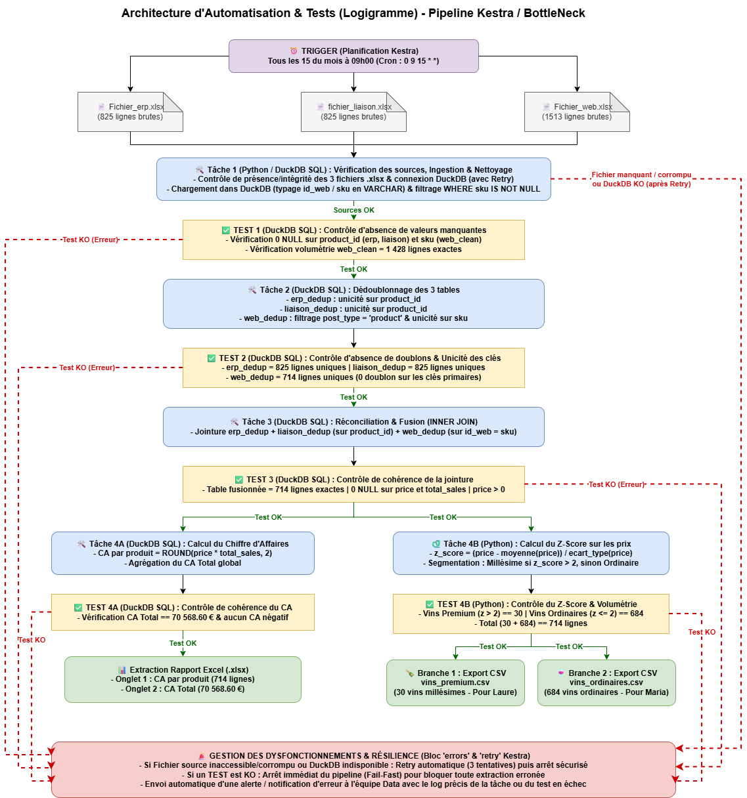

# 🍷 BottleNeck — Pipeline d'Orchestration & Réconciliation de Données (Kestra / DuckDB / Python)

## 1. Contexte & Objectifs Métier
**BottleNeck**, marchand de vin spécialisé, dispose de deux systèmes d'information distincts :
* Un système **ERP** gérant les références produits, les prix unitaires et les stocks (`Fichier_erp.xlsx`).
* Une plateforme e-commerce **CMS** centralisant les ventes en ligne et les métadonnées produits (`Fichier_web.xlsx`).
* Une table de correspondance permettant le rapprochement des identifiants (`fichier_liaison.xlsx`).

Ce projet industrialise et automatise le pipeline mensuel d'intégration, de nettoyage, de contrôle qualité (*Fail-Fast*) et d'analyse des données afin de générer automatiquement **chaque 15 du mois à 09h00** :
1. **`rapport_chiffre_affaires.xlsx`** : Rapport financier Excel à deux onglets (`CA_par_produit` et `CA_Total`).
2. **`vins_premium.csv`** : Extraction des vins millésimes identifiés statistiquement par la méthode du Z-score ($z > 2$) pour le ciblage B2B.
3. **`vins_ordinaires.csv`** : Extraction des vins courants ($z \le 2$) pour les campagnes B2C.

---

## 2. Architecture du Pipeline & Stratégie de Tests (Fail-Fast)

L'orchestration est assurée par **Kestra** et sépare strictement la logique d'ordonnancement du traitement de la donnée, délégué à **DuckDB** (SQL analytique) et **Python** (`pandas`). Chaque étape de transformation est immédiatement validée par une tâche de test automatisée bloquant le flux en cas d'anomalie :



### Synthèse des contrôles qualité et métriques de référence

| Étape | Traitement exécuté | Test Automatisé (Fail-Fast) | Résultat validé |
| :--- | :--- | :--- | :--- |
| **1. Ingestion & Nettoyage** | Contrôle des sources `.xlsx`, typage `VARCHAR` (`id_web`, `sku`), filtrage des clés `NULL` | **Test 1 :** `0 NULL` sur les clés primaires et contrôle volumétrique `web_clean` | `erp`: 825 \| `liaison`: 825 \| `web`: **1 428 lignes** |
| **2. Dédoublonnage SQL** | Unicité sur `product_id` et filtrage `post_type = 'product'` + unicité sur `sku` | **Test 2 :** `COUNT(*) == COUNT(DISTINCT clé)` sur les 3 tables | `erp`: **825** \| `liaison`: **825** \| `web`: **714 lignes** |
| **3. Réconciliation** | Double `INNER JOIN` SQL (`erp_dedup` $\leftrightarrow$ `liaison_dedup` $\leftrightarrow$ `web_dedup`) | **Test 3 :** Volumétrie exacte, `0 NULL` sur `price`/`total_sales`, `price > 0` | **714 produits** réconciliés |
| **4A. Reporting CA** | Calcul SQL du CA par produit (`ROUND(price * total_sales, 2)`) et du CA global | **Test 4A :** Aucun CA négatif et contrôle strict du montant total agrégé | **70 568,60 €** (sur 714 produits) |
| **4B. Segmentation** | Calcul Python du Z-score sur les prix : $z = \frac{x - \mu}{\sigma}$ ($\text{ddof}=0$) | **Test 4B :** Vérification de la partition complète ($30 + 684 = 714$) | **30 Vins Premium** ($z > 2$) \| **684 Vins Ordinaires** ($z \le 2$) |

### Anomalies métier identifiées lors de l'audit des sources
* **Références ERP à prix négatifs :** 2 références (`product_id = 5017` à `-8,00 €` et `product_id = 6594` à `-1,00 €`) figurent dans l'ERP avec `onsale_web = 0` et sans `id_web`. Elles sont écartées par la jointure interne et surveillées par le **Test 3** (`price > 0`).
* **Produits CMS sans clé `sku` :** Sur les 85 lignes sans `sku` dans `Fichier_web.xlsx`, 2 lignes correspondent à des fiches produits actives (*Pierre Jean Villa Condrieu Jardin Suspendu 2018* et *Pierre Jean Villa Côte Rôtie Fongeant 2017*) devant être corrigées dans le CMS.

---

## 3. Structure du Dépôt

```text
.
├── data/
│   ├── inputs/                                    # Exports sources (.xlsx : ERP, Liaison, Web)
│   └── outputs/                                   # Livrables générés par le pipeline
│       ├── rapport_chiffre_affaires.xlsx          # Rapport financier (CA_par_produit, CA_Total)
│       ├── vins_premium.csv                       # Extraction des 30 vins millésimes (z > 2)
│       └── vins_ordinaires.csv                    # Extraction des 684 vins ordinaires (z <= 2)
├── docker-compose.yml                             # Stack Docker (Kestra Standalone + PostgreSQL 16)
├── Mahmoud_Amin_1_diagramme_102026.drawio         # Logigramme d'architecture (Draw.io)
├── Mahmoud_Amin_1_diagramme_102026.drawio.png     # Export visuel de l'architecture
├── Mahmoud_Amin_2_workflow_102026.yaml            # Workflow Kestra déclaratif & tests intégrés
└── README.md                                      # Documentation technique
```

---

## 4. Déploiement & Exécution

```bash
# 1. Démarrer l'infrastructure Docker (Kestra + PostgreSQL 16)
docker compose up -d

# 2. Accéder à l'interface Kestra sur http://localhost:8080
# 3. Importer le flux Mahmoud_Amin_2_workflow_102026.yaml et lancer une exécution
```
